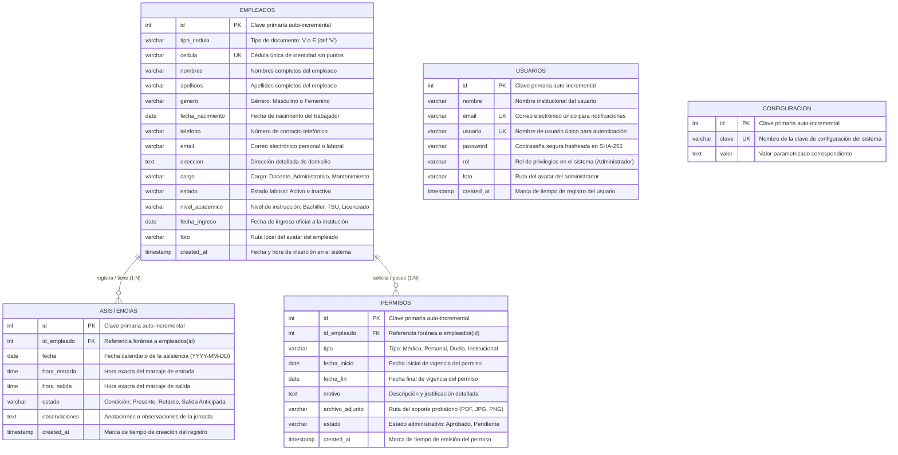

# DIAGRAMA ENTIDAD-RELACIÓN Y DICCIONARIO DE DATOS

## SISTEMA DE CONTROL DE ASISTENCIA PARA EL CENTRO DE EDUCACIÓN INICIAL SIMÓN DÍAZ

---

### 📋 Ficha Técnica del Proyecto
* **Título Oficial:** SISTEMA DE CONTROL DE ASISTENCIA PARA EL CENTRO DE EDUCACIÓN INICIAL SIMÓN DÍAZ PARROQUIA VALMORE RODRÍGUEZ, MUNICIPIO SUCRE

* **Autores e Investigadores:**
  * **Danibel Palomares**
  * **Miguel Ramirez**
* **Institución Beneficiaria:** Centro de Educación Inicial (C.E.I.) "Simón Díaz".
* **Ubicación:** Parroquia Valmore Rodríguez, Municipio Sucre, Estado Trujillo, Venezuela.
* **Gestor de Base de Datos:** MariaDB 11.x (Motor InnoDB, Intercalación `utf8mb4_unicode_ci`).
* **Entorno de Despliegue:** Contenedor Docker Oficial (`mariadb:11`).

---

## 📑 Tabla de Contenidos

1. [Introducción al Modelo de Datos](#-introducción-al-modelo-de-datos)
2. [Diagrama Entidad-Relación (Mermaid)](#-diagrama-entidad-relación-mermaid)
3. [Diccionario Exhaustivo de Datos](#-diccionario-exhaustivo-de-datos)
   * [Tabla 1: `usuarios` (Administradores del Sistema)](#tabla-1-usuarios-administradores-del-sistema)
   * [Tabla 2: `empleados` (Personal de la Institución)](#tabla-2-empleados-personal-de-la-institución)
   * [Tabla 3: `asistencias` (Registro Diario de Marcajes)](#tabla-3-asistencias-registro-diario-de-marcajes)
   * [Tabla 4: `permisos` (Permisos y Reposos Institucionales)](#tabla-4-permisos-permisos-y-reposos-institucionales)
   * [Tabla 5: `configuracion` (Variables Globales de Sistema)](#tabla-5-configuracion-variables-globales-de-sistema)
4. [Análisis de Cardinalidades e Integridad Referencial](#-análisis-de-cardinalidades-e-integridad-referencial)
5. [Optimizaciones, Índices y Seguridad de Datos](#-optimizaciones-índices-y-seguridad-de-datos)
6. [Guía para Visualizar y Exportar el Diagrama](#-guía-para-visualizar-y-exportar-el-diagrama)
   * [Opción A: Visualización en Visual Studio Code](#opción-a-visualización-en-visual-studio-code)
   * [Opción B: Editor en Línea (Mermaid Live Editor)](#opción-b-editor-en-línea-mermaid-live-editor)
   * [Opción C: Exportación por Consola con Mermaid CLI](#opción-c-exportación-por-consola-con-mermaid-cli)

---

## 📌 Introducción al Modelo de Datos

El diseño de la base de datos relacional para el **C.E.I. Simón Díaz** se fundamenta en los principios de normalización relacional (Tercera Forma Normal - 3FN), garantizando la integridad de la información, eliminando redundancias y facilitando la trazabilidad de los registros de asistencia y reposos médicos del personal.

La estructura se apoya en 5 entidades principales:
1. **`empleados`**: Núcleo del sistema escolar que almacena el expediente del talento humano (docentes, administrativos, obreros).
2. **`asistencias`**: Bitácora cronometrada de marcajes de entrada y salida, vinculada a cada empleado.
3. **`permisos`**: Registro de justificaciones de inasistencia con soporte de documentos probatorios adjuntos.
4. **`usuarios`**: Gestión de credenciales, roles y avatares para los operadores del sistema.
5. **`configuracion`**: Tabla de parámetros clave-valor para la personalización institucional.

---

## 📊 Diagrama Entidad-Relación (Mermaid)

El siguiente diagrama formal modela las relaciones lógicas, claves primarias (`PK`), claves foráneas (`FK`), restricciones únicas (`UK`) y cardinalidades entre las entidades del sistema:



---

## 📖 Diccionario Exhaustivo de Datos

A continuación se detalla la especificación técnica de cada una de las tablas del esquema físico `cei_simondiaz` en MariaDB:

### Tabla 1: `usuarios` (Administradores del Sistema)
Almacena los usuarios autorizados para operar la plataforma y emitir reportes institucionales.

| Nombre del Campo | Tipo de Dato | Tamaño | Clave | Nulo | Valor por Defecto | Descripción y Regla de Negocio |
| :--- | :--- | :--- | :---: | :---: | :--- | :--- |
| `id` | `INT` | 11 | **PK** | No | *AUTO_INCREMENT* | Identificador secuencial único e inmutable del usuario. |
| `nombre` | `VARCHAR` | 150 | - | No | Ninguno | Nombre y apellido del administrador o directivo escolar. |
| `email` | `VARCHAR` | 150 | **UK** | No | Ninguno | Dirección de correo electrónico única para acceso o notificaciones. |
| `usuario` | `VARCHAR` | 100 | **UK** | No | Ninguno | Nombre de usuario alfanumérico para el inicio de sesión. |
| `password` | `VARCHAR` | 255 | - | No | Ninguno | Hash criptográfico generado mediante algoritmo seguro SHA-256. |
| `rol` | `VARCHAR` | 50 | - | Sí | `'Administrador'` | Nivel de privilegio del usuario (por defecto 'Administrador'). |
| `foto` | `VARCHAR` | 255 | - | Sí | `'/uploads/admin/default-admin.png'` | Ruta relativa hacia la imagen de avatar del perfil. |
| `created_at` | `TIMESTAMP` | - | - | Sí | `CURRENT_TIMESTAMP` | Marca temporal automática de creación del registro. |

---

### Tabla 2: `empleados` (Personal de la Institución)
Contiene la ficha laboral y personal de cada docente, administrativo y personal obrero del plantel.

| Nombre del Campo | Tipo de Dato | Tamaño | Clave | Nulo | Valor por Defecto | Descripción y Regla de Negocio |
| :--- | :--- | :--- | :---: | :---: | :--- | :--- |
| `id` | `INT` | 11 | **PK** | No | *AUTO_INCREMENT* | Identificador secuencial primario del empleado. |
| `tipo_cedula` | `VARCHAR` | 2 | - | Sí | `'V'` | Nacionalidad del documento: `'V'` (Venezolano) o `'E'` (Extranjero). |
| `cedula` | `VARCHAR` | 20 | **UK** | No | Ninguno | Número de cédula de identidad único (ej. `32026099`). Clave para marcaje. |
| `nombres` | `VARCHAR` | 100 | - | No | Ninguno | Nombres de pila del empleado. |
| `apellidos` | `VARCHAR` | 100 | - | No | Ninguno | Apellidos paterno y materno del empleado. |
| `genero` | `VARCHAR` | 20 | - | No | Ninguno | Género biológico (`Masculino` o `Femenino`). |
| `fecha_nacimiento` | `DATE` | - | - | Sí | `NULL` | Fecha de nacimiento para cálculo de edad y jubilaciones. |
| `telefono` | `VARCHAR` | 30 | - | Sí | `NULL` | Número de teléfono de contacto personal o de emergencia. |
| `email` | `VARCHAR` | 150 | - | Sí | `NULL` | Correo electrónico personal para comunicaciones institucionales. |
| `direccion` | `TEXT` | - | - | Sí | `NULL` | Dirección geográfica de residencia permanente del trabajador. |
| `cargo` | `VARCHAR` | 100 | - | No | Ninguno | Cargo institucional asignado (`Docente`, `Administrativo`, `Mantenimiento`). |
| `estado` | `VARCHAR` | 20 | - | Sí | `'Activo'` | Estatus laboral: `'Activo'` o `'Inactivo'`. |
| `nivel_academico` | `VARCHAR` | 100 | - | Sí | `NULL` | Grado de instrucción formal (`Bachiller`, `TSU`, `Licenciado`, `Magíster`). |
| `fecha_ingreso` | `DATE` | - | - | Sí | `NULL` | Fecha de alta laboral oficial en el C.E.I. Simón Díaz. |
| `foto` | `VARCHAR` | 255 | - | Sí | `'/public/assets/default-avatar.png'` | Ruta a la fotografía del empleado o silueta institucional por defecto. |
| `created_at` | `TIMESTAMP` | - | - | Sí | `CURRENT_TIMESTAMP` | Fecha y hora en la que fue registrado el empleado en el sistema. |

---

### Tabla 3: `asistencias` (Registro Diario de Marcajes)
Registra cada marcaje cronometrado efectuado por los trabajadores en el panel de inicio.

| Nombre del Campo | Tipo de Dato | Tamaño | Clave | Nulo | Valor por Defecto | Descripción y Regla de Negocio |
| :--- | :--- | :--- | :---: | :---: | :--- | :--- |
| `id` | `INT` | 11 | **PK** | No | *AUTO_INCREMENT* | Identificador secuencial primario del evento de asistencia. |
| `id_empleado` | `INT` | 11 | **FK** | No | Ninguno | Clave foránea que referencia a `empleados(id)`. |
| `fecha` | `DATE` | - | - | No | Ninguno | Fecha de la jornada laboral evaluada (formato `YYYY-MM-DD`). |
| `hora_entrada` | `TIME` | - | - | Sí | `NULL` | Hora exacta del primer marcaje del día (formato `HH:MM:SS`). |
| `hora_salida` | `TIME` | - | - | Sí | `NULL` | Hora exacta del segundo marcaje del día (cierre de jornada). |
| `estado` | `VARCHAR` | 50 | - | Sí | `'Presente'` | Estatus calculado de la jornada: `'Presente'`, `'Retardo'` o `'Salida Anticipada'`. |
| `observaciones` | `TEXT` | - | - | Sí | `NULL` | Notas u observaciones adicionales relativas a la asistencia diaria. |
| `created_at` | `TIMESTAMP` | - | - | Sí | `CURRENT_TIMESTAMP` | Marca temporal automática del servidor al registrar el marcaje. |

---

### Tabla 4: `permisos` (Permisos y Reposos Institucionales)
Almacena las solicitudes, reposos médicos y permisos institucionales aprobados al personal.

| Nombre del Campo | Tipo de Dato | Tamaño | Clave | Nulo | Valor por Defecto | Descripción y Regla de Negocio |
| :--- | :--- | :--- | :---: | :---: | :--- | :--- |
| `id` | `INT` | 11 | **PK** | No | *AUTO_INCREMENT* | Identificador primario secuencial del permiso concedido. |
| `id_empleado` | `INT` | 11 | **FK** | No | Ninguno | Clave foránea que vincula el permiso con `empleados(id)`. |
| `tipo` | `VARCHAR` | 50 | - | No | Ninguno | Naturaleza de la ausencia (`Médico`, `Personal`, `Duelo`, `Institucional`). |
| `fecha_inicio` | `DATE` | - | - | No | Ninguno | Primer día de vigencia oficial del permiso. |
| `fecha_fin` | `DATE` | - | - | No | Ninguno | Último día de vigencia oficial del permiso. |
| `motivo` | `TEXT` | - | - | Sí | `NULL` | Justificación descriptiva del permiso o diagnóstico médico. |
| `archivo_adjunto` | `VARCHAR` | 255 | - | Sí | `NULL` | Ruta del archivo digital comprobatorio (PDF o imagen escaneada). |
| `estado` | `VARCHAR` | 50 | - | Sí | `'Aprobado'` | Estado administrativo del trámite: `'Aprobado'`, `'En Revisión'`, `'Finalizado'`. |
| `created_at` | `TIMESTAMP` | - | - | Sí | `CURRENT_TIMESTAMP` | Marca de tiempo del registro en el sistema. |

---

### Tabla 5: `configuracion` (Variables Globales de Sistema)
Estructura tipo clave-valor para almacenar parámetros dinámicos de la institución y del perfil directivo.

| Nombre del Campo | Tipo de Dato | Tamaño | Clave | Nulo | Valor por Defecto | Descripción y Regla de Negocio |
| :--- | :--- | :--- | :---: | :---: | :--- | :--- |
| `id` | `INT` | 11 | **PK** | No | *AUTO_INCREMENT* | Clave primaria auto-incremental. |
| `clave` | `VARCHAR` | 50 | **UK** | No | Ninguno | Identificador textual único del parámetro (`admin_nombre`, `admin_foto`, etc.). |
| `valor` | `TEXT` | - | - | Sí | `NULL` | Contenido o valor parametrizado asociado a la clave. |

---

## 🔗 Análisis de Cardinalidades e Integridad Referencial

### 1. Relación: `empleados` — `asistencias` (1 a N)
* **Cardinalidad**: Un empleado puede tener **cero, una o múltiples (N)** asistencias a lo largo del año lectivo (`1:N`). Cada registro de asistencia pertenece a **un y solo un** empleado (`N:1`).
* **Integridad Referencial**:
  ```sql
  FOREIGN KEY (`id_empleado`) REFERENCES `empleados`(`id`) ON DELETE CASCADE
  ```
  La regla `ON DELETE CASCADE` asegura que, si un registro de empleado es eliminado del sistema, todas sus asistencias asociadas se limpien automáticamente sin generar registros huérfanos.

### 2. Relación: `empleados` — `permisos` (1 a N)
* **Cardinalidad**: Un empleado puede registrar **cero, uno o múltiples (N)** permisos o reposos médicos durante su ejercicio laboral (`1:N`). Cada permiso corresponde estrictamente a **un** empleado (`N:1`).
* **Integridad Referencial**:
  ```sql
  FOREIGN KEY (`id_empleado`) REFERENCES `empleados`(`id`) ON DELETE CASCADE
  ```
  Al igual que en asistencias, la regla en cascada protege la integridad de los datos evitando desincronizaciones en caso de baja laboral definitiva.

### 3. Entidad Independiente: `usuarios`
* Contiene las cuentas con privilegios administrativos para acceder al sistema. Funciona de manera autónoma con claves únicas (`email` y `usuario`), separando los roles de operadores de los expedientes de personal.

### 4. Entidad Independiente: `configuracion`
* Almacena parámetros globales de persistencia del sistema (nombre institucional, avatares directivos, títulos oficiales) mediante una clave única `clave` para consultas ultrarrápidas de tipo `SELECT valor FROM configuracion WHERE clave = ?`.

---

## ⚙️ Optimizaciones, Índices y Seguridad de Datos

1. **Índices de Búsqueda Rápida**:
   * `empleados(cedula)`: Cuenta con un índice único (`UNIQUE KEY`), optimizando la consulta de marcaje rápido en el inicio a tiempo constante $O(1)$.
   * `usuarios(usuario)` y `usuarios(email)`: Índices únicos para garantizar validaciones de login inmediatas.
2. **Motor de Almacenamiento InnoDB**:
   * Todas las tablas utilizan `ENGINE=InnoDB`, soportando transacciones ACID (Atomicidad, Consistencia, Aislamiento y Durabilidad), bloqueo a nivel de fila y claves foráneas reales.
3. **Codificación `utf8mb4`**:
   * El juego de caracteres `utf8mb4` con intercalación `utf8mb4_unicode_ci` asegura compatibilidad total con el idioma español (acentos, virgulillas de la eñe, diéresis) y caracteres tipográficos especiales.

---

## 🖥️ Guía para Visualizar y Exportar el Diagrama

El bloque Mermaid presentado en este documento es un estándar abierto de diagramación como código. Puedes visualizarlo y exportarlo en alta definición de las siguientes maneras:

### Opción A: Visualización en Visual Studio Code
1. Abre este archivo `diagrama-er.md` en **Visual Studio Code**.
2. Presiona la combinación de teclas `Ctrl + Shift + V` (o `Ctrl + K, V`) para abrir la vista previa de Markdown.
3. Si utilizas la extensión oficial **Markdown Preview Mermaid Support** (de Matt Bierner), el diagrama se renderizará automáticamente como un gráfico vectorial interactivo.

### Opción B: Editor en Línea (Mermaid Live Editor)
1. Copia el bloque de código que se encuentra entre ` ```mermaid ` y ` ``` `.
2. Ingresa en tu navegador a: 👉 **[https://mermaid.live](https://mermaid.live)**.
3. Pega el código en el panel izquierdo ("Code").
4. El diagrama se dibujará instantáneamente en el panel derecho.
5. Puedes exportarlo directamente en formato **PNG**, **SVG** o copiar el enlace para compartirlo.

### Opción C: Exportación por Consola con Mermaid CLI
Si deseas compilar el diagrama a imagen o PDF directamente desde la terminal del sistema:

1. Instala la herramienta de línea de comandos de Mermaid:
   ```bash
   npm install -g @mermaid-js/mermaid-cli
   ```
2. Genera una imagen PNG en alta resolución:
   ```bash
   mmdc -i diagrama-er.md -o diagrama-entidad-relacion.png -b transparent
   ```
3. O genera un gráfico vectorial SVG escalable:
   ```bash
   mmdc -i diagrama-er.md -o diagrama-entidad-relacion.svg
   ```